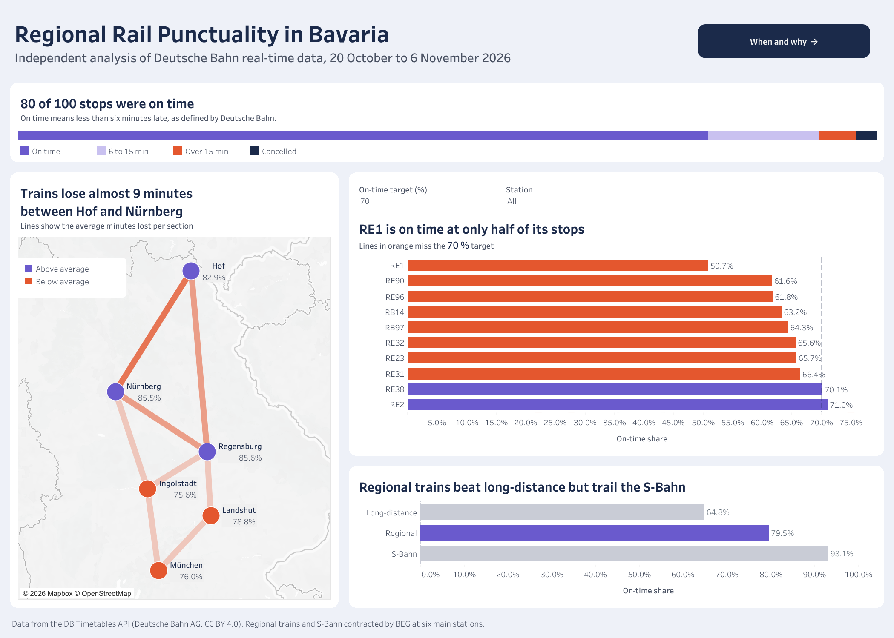

# db-delay-dwh → Regional Rail Punctuality in Bavaria

**How punctual is regional rail in Bavaria? Where does it fall short?** A data warehouse for Deutsche Bahn real-time data. It is built with Python, PostgreSQL and Docker. The data is analysed with SQL and visualised in Tableau Public.

Own case study for the capstone of the Google Data Analytics Professional Certificate. Stakeholder: Bayerische Eisenbahngesellschaft (BEG), which contracts regional rail in Bavaria.

**[View the interactive dashboard on Tableau Public](https://public.tableau.com/app/profile/philipp.sch.nfeld/viz/bahn_punctuality_dashboard/Whereandwhichlines)**

[](https://public.tableau.com/app/profile/philipp.sch.nfeld/viz/bahn_punctuality_dashboard/Whereandwhichlines)

---

## Key findings

Data: 25,106 stops at six main stations (München, Nürnberg, Regensburg, Ingolstadt, Landshut, Hof), 20 Oct - 6 Nov 2026.

- **82 % on time.** 82.4 % of the regional and S-Bahn stops that ran were less than six minutes late (Deutsche Bahn definition).
- **One line stands out.** RE1 is the least punctual line at all three stations it serves and is on time at only 50.7 % of its stops.
- **One corridor stands out.** Between Hof and Nürnberg, journeys lose almost 9 minutes, in both directions.
- **Late evening is worst.** Punctuality is lowest at 11 p.m. (75.4 %).
- **Hof was a temporary event.** Almost all cancellations at Hof fall within four days (20 - 23 Oct).
- **Regional rail in context.** 79.5 % on time, between long-distance trains (64.8 %) and the S-Bahn (93.1 %).

The full analysis, following the six phases Ask, Prepare, Process, Analyze, Share and Act, is in the [case study](docs/CASE_STUDY.md).

---

## Architecture

```
DB Timetables API (XML)
        │  hourly, Python collector
        ▼
staging   raw values as delivered, upsert on (eva, stop_id)     sql/01_staging.sql
        ▼
core      cleaned view: one row per stop, delays, flags         sql/02_core.sql
        ├──► analysis   queries for the guiding questions       sql/03_analysis.sql
        ▼
mart      views prepared for the dashboard                      sql/04_mart.sql
        ▼
CSV export ──► Tableau Public dashboard                         exports/
```

The API only returns the current day, so the history had to be collected continuously. The raw data is never overwritten. Every cleaning step is a documented SQL expression in a view.

## Tools and techniques

| Area | Tools and techniques |
|---|---|
| Collection | Python (`requests`, `psycopg`), XML parsing, Windows Task Scheduler |
| Storage | PostgreSQL 17 in Docker, layered model (staging, core, mart), composite primary keys, upsert (`ON CONFLICT`) |
| Cleaning and verification | views, `COALESCE`, `CASE`, regular expressions, type conversion, outlier flags, verification queries |
| Analysis | CTEs, window functions (`RANK()`, `LAG()`), `FILTER`, `percentile_cont`, `HAVING`, `UNION ALL` |
| Visualisation | Tableau Public: calculated fields, parameters, dual-layer map, dashboard actions |
| Documentation | case study, data dictionary, changelog, Git |

---

## Repository structure

```
├── ingestion/
│   ├── fetch_samples.py      download raw API responses, find station IDs
│   ├── inspect_xml.py        inventory of all XML fields
│   └── collector.py          API → PostgreSQL staging (hourly)
├── sql/
│   ├── 01_staging.sql        staging tables
│   ├── 02_core.sql           cleaned view core.stops
│   ├── 03_analysis.sql       queries for the guiding questions Q1 - Q6
│   └── 04_mart.sql           views for the dashboard
├── exports/                  CSV files for Tableau Public
├── samples/                  raw API responses (XML)
├── docs/
│   ├── CASE_STUDY.md         the full case study
│   ├── DATA_DICTIONARY.md    every table and field
│   ├── CHANGELOG.md          all changes to collection and cleaning
│   └── images/               dashboard screenshots
├── docker-compose.yml        PostgreSQL 17
├── run_collector.bat         hourly run via Windows Task Scheduler
├── requirements.txt
└── .env.example              template for credentials
```

---

## How to reproduce

Requirements: Python 3.12+, Docker Desktop, an account at the [DB API Marketplace](https://developers.deutschebahn.com) with a subscription to the Timetables API (free).

```bat
:: 1. environment and credentials
python -m venv .venv
.venv\Scripts\activate
pip install -r requirements.txt
copy .env.example .env          :: then fill in your own values

:: 2. database and staging tables
docker compose up -d
docker exec -i bahn-postgres psql -U bahn -d bahn_dwh < sql\01_staging.sql

:: 3. collect data (run hourly, e.g. with run_collector.bat in the Task Scheduler)
python ingestion\collector.py

:: 4. cleaning, analysis and dashboard data
docker exec -i bahn-postgres psql -U bahn -d bahn_dwh < sql\02_core.sql
docker exec -i bahn-postgres psql -U bahn -d bahn_dwh < sql\03_analysis.sql
docker exec -i bahn-postgres psql -U bahn -d bahn_dwh < sql\04_mart.sql
```

Step 4 can be repeated at any time. The CSV export commands are in [`exports/README.md`](exports/README.md). A new collection covers a new period, so the results will differ from this case study.

---

## Data source and licence

Deutsche Bahn AG, [DB Timetables API](https://developers.deutschebahn.com/db-api-marketplace/apis/product/timetables), licensed under [CC BY 4.0](https://creativecommons.org/licenses/by/4.0/). The data was cleaned and prepared for this project.

Code: MIT License (see `LICENSE`).

